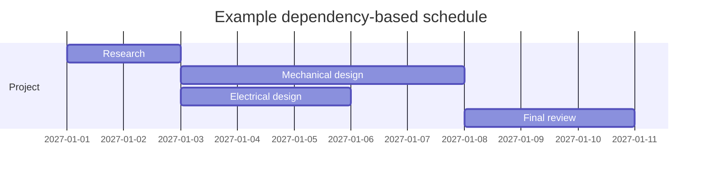

# Project Management System — Codex Implementation Specification

## 1. Objective and delivery
Build a complete, self-hosted, multi-team project management application for collaborative engineering work. Deliver working, persistent, authorized functionality, not a prototype. Inspect the existing repository before changing it; preserve unrelated working code. Implement in phases, run tests after each phase, and continue beyond scaffolding. Record decisions and deviations.

## 2. Technology and deployment
- PHP 8.3+, MariaDB, PDO prepared statements, Composer PSR-4 autoloading, strict MVC.
- Bootstrap 5.3, Bootstrap Icons, vanilla ES6+ JavaScript, Fetch API, HTML/CSS. No React, Vue or Angular. Use SortableJS or equivalent, FullCalendar or equivalent, and a suitable Gantt library or custom implementation. Prefer locally hosted dependencies and document licenses.
- Dockerfile, docker-compose.yml, .env.example, health checks, persistent database and upload storage, versioned migrations, development seeds, .gitignore, .dockerignore, README. Environment variables for deployment-specific settings. Production seeds must never run automatically.

## 3. Architecture and coding conventions
Strictly separate controllers, models, views, middleware and routes. Controllers coordinate requests, validation, authorization and responses; models manage domain data and persistence; views present data only. No SQL in views or large SQL/HTML blocks in controllers. Reusable infrastructure and complex business logic belong in focused classes under lib/. No global helper functions, shared global objects, miscellaneous helper scripts, service locator, or generic Helpers/Utils/Common catch-all classes. Use explicit dependency injection, namespaces, a single public entry point, explicit routes, small cohesive classes and reusable view components. Refactor duplication rather than creating loose helper code. No shared application classes outside the prescribed structure; third-party packages belong in vendor/.

```text
app/
  Controllers/
  Models/
  Views/{Layouts,Components,Teams,SubTeams,Projects,Tasks,Users,Archive,Calendar,Gantt}/
  Middleware/
  Routes/
lib/
  Core/
  Database/
  Authentication/
  Authorization/
  Scheduling/
  Validation/
  Storage/
  Configuration/
  Notifications/
config/
database/{migrations,seeds}/
public/index.php
public/assets/{css,js,images,vendor}/
storage/{uploads,cache,logs}/
tests/
docs/
composer.json
Dockerfile
docker-compose.yml
.env.example
README.md
AGENTS.md
```

### YYCGuy PHP style (all application-owned PHP)
- `declare(strict_types=1);`, typed parameters, properties and return values where appropriate.
- No private methods or properties; protected and public only.
- Protected methods and properties begin with `_`; public methods and properties use camelCase; classes use PascalCase.
- Each class has large comment section headers in this exact order: protected variables, public variables, magic methods, protected methods, public methods. Magic methods belong in their own section even though public. Third-party code exempt.

```php
<?php

declare(strict_types=1);

namespace ProjectManager\Models;

class Project
{
    /* ============================================================
     * PROTECTED VARIABLES
     * ============================================================ */
    protected int $_id;

    /* ============================================================
     * PUBLIC VARIABLES
     * ============================================================ */
    public string $title;

    /* ============================================================
     * MAGIC METHODS
     * ============================================================ */
    public function __construct(int $id)
    {
        $this->_id = $id;
    }

    /* ============================================================
     * PROTECTED METHODS
     * ============================================================ */
    protected function _validate(): bool
    {
        return $this->_id > 0;
    }

    /* ============================================================
     * PUBLIC METHODS
     * ============================================================ */
    public function getId(): int
    {
        return $this->_id;
    }
}
```

Separate JS into scoped modules for Kanban, Gantt, calendar, task dialogue and administration. Centralize API requests and error handling. No large inline scripts or unnecessary global state. Routine CRUD should not require page reloads.

## 4. OIDC authentication and user management
Use external OIDC exclusively, no local password system. Support configurable issuer, client ID/secret, redirect/logout URIs, scopes, claim mappings and optional trusted group/role mappings. Support Pocket ID and other standards-compliant providers. Authorization Code with PKCE; validate signature, issuer, audience, state, nonce, expiry and other required claims. Store users by issuer + subject, not email. Provision first-time users without privileges; administrators approve and assign memberships. Subsequent logins update profile fields without overwriting locally managed permissions. Bootstrap initial global administrator through explicitly configured verified OIDC identity, never first-login-wins.

User profiles: first/last/display name, email, avatar, status, team/sub-team memberships, roles, projects, tasks, ownership, last login and creation date. Deactivation preserves historical contributions and revokes access. User administration: searchable/sortable/filterable list, profile, memberships, roles, project/task lists, ownership, workload, activation/deactivation and bulk operations. Only expose administrative account details to authorized administrators; ordinary members can see collaboration-relevant identity, memberships, project/task roles and contact information.

### User replacement
Provide individual project replacement, selected-project batch replacement, all authorized projects, task-level replacement, optional project assignments and ownership replacement, optional archived inclusion. Preview exactly affected records before commit. Validate scope and replacement eligibility; prevent duplicate assignments. Do not change comment/research authorship or historical audit records. Execute atomically and log results.

## 5. Authorization — cross-team visibility is mandatory
**All active, approved members of the organization can view all teams, sub-teams, projects, tasks, assigned members, task owners, milestones, schedules, collaboration content (comments and research), and applicable Important Dates across teams, regardless of their own team/sub-team membership.** This enables cross-team coordination and finding the appropriate contacts. Do not apply team membership filters to ordinary read endpoints. All authenticated but unapproved or deactivated accounts must be denied this access. Archived projects remain excluded from active views; approved members can browse archive history read-only. Administrative audit records, secrets and sensitive account information remain restricted.

Visibility is distinct from mutation permission. Viewing another team's work does not grant editing, self-assignment, membership changes or administration. Explicit cross-team assignments may grant participation rights without granting membership or administrative rights in the destination team. Administrators may explicitly assign eligible active approved members from other teams; clearly label their home team and require explicit selection rather than silently expanding membership. The default task selector shows project members, then other members of the parent team, then an explicit cross-team selector where authorized. Users from unrelated teams must not be automatically assigned. Assignment outside the project must not automatically make someone a project member; offer an explicit option.

| Capability | Approved member | Assigned participant / owner | Sub-team admin | Team admin | Global admin |
|---|---|---|---|---|---|
| View collaboration data across all teams | Yes | Yes | Yes | Yes | Yes |
| Edit task / timeline | No by default | Authorized assigned/owned tasks | Own sub-team | Own team and descendants | All |
| Take ownership of unowned task | Only eligible project members | Yes if eligible | Own scope | Own scope | All |
| Comment / research contribution | Only authorized participants | Yes in authorized scope | Own scope | Own scope | All |
| Manage projects, archives, copies, assignments | No | No by default | Own sub-team | Own team and descendants | All |
| Manage memberships and scoped roles | No | No | Own sub-team, limited delegation | Own team and descendants | All |
| Manage global settings and administrators | No | No | No | No | Yes |

Users may belong to multiple teams/sub-teams and hold different roles per scope. Team admins manage team settings, sub-team CRUD, membership, sub-team admins, projects, tasks, dates, archive and replacements in their team. Sub-team admins have equivalent authority only within their sub-team and cannot administer the parent or siblings. Privileges inherit downward, never upward. No scoped admin can grant global privileges. Enforce authorization centrally in lib/Authorization/ for every page, API endpoint, file download and mutation. Hiding UI is not authorization. Test cross-team reads explicitly, including direct URLs, search, Gantt, calendar and archive; test that cross-team writes remain denied unless specifically authorized.

## 6. Teams and sub-teams
Complete CRUD. A sub-team belongs to exactly one parent team. Projects belong directly to a team or to one of its sub-teams. Properties: name, slug, description, colour, icon, optional logo, members/admins, active status, display order and timestamps. Prevent destructive deletion of scopes containing projects/history without explicit resolution. Maintain referential integrity.

## 7. Projects
Complete CRUD. Fields: ID, title, description, team, optional sub-team, project lead, multiple assigned members, priority, colour, tags, status (Planned, Active, On Hold, Completed, Cancelled), planned and actual start, calculated and optional target completion, actual completion, duration, progress, scheduling mode, dependencies where appropriate, archive state, creator and timestamps. Archiving independent of status. Allow authorized moves between scopes after validating assignments and access. Project navigation: Overview, Kanban, Gantt, Calendar, Members, Activity, Settings. Overview shows progress, milestones, outstanding tasks, members, schedule warnings and Important Dates.

## 8. Tasks
Complete CRUD. Fields: ID, project, title, description, status, priority, tags, multiple assigned members, optional single primary owner, planned/actual start, calculated and optional manual due date, actual completion, estimated duration, milestones, dependencies, progress, research, attachments, comments, Kanban ordering and timestamps.

Exact status columns, in order:
1. Not Started
2. Researching
3. In-Progress
4. Needs Outside Input
5. Needs Review
6. Done

Member selection defaults to project members; expandable searchable parent-team list; explicit cross-team selection as described in authorization. Prevent duplicates. Support ownership claiming by eligible project members, relinquishing, transferring, admin reassignment and ownership history. Taking ownership should add the owner as a task assignee if not already assigned.

## 9. Milestones and adaptive scheduling
Centralize scheduling in independently testable lib/Scheduling/. Task milestones are ordered stages with title, description, duration in days, computed cumulative offset, computed calendar date, completion state, actual completion, optional members and notes. Full CRUD and drag/reorder. Enter durations rather than requiring absolute dates. Display both task-relative and project-relative offsets. Example:

| Milestone | Stage duration | Task-relative day |
|---|---:|---:|
| Find three products similar to concept | 2 | 2 |
| Compare specifications | 3 | 5 |
| Develop concept | 2 | 7 |
| Review | 1 | 8 |

Task duration = sum of stage durations. If no milestones, use manually entered duration. Project duration is the span of scheduled tasks, not their sum. Independent tasks can run concurrently. Support finish-to-start dependencies, optional lag, cycle detection and conflict reporting. Automatic mode derives dates from project start, dependencies and duration; manual mode supports locked dates, warns of conflicts and never silently overwrites locks. When duration, dependency, start date or milestones change, recalculate affected future dates and project finish, preserve actual history, warn about missed target deadlines and log material changes. Preview major changes. Define consistent day-zero boundary semantics: project start is day 0, a two-day stage ends at the day-2 boundary; document display conventions for inclusive calendar views. Support calendar days and configurable working days/holidays/timezone.

Example: Research 2 days; mechanical design 5 days and electrical design 3 days both depend on research; review 3 days depends on both designs. Total 10 days. Increasing mechanical design to 7 days shifts review by 2 days and total to 12; electrical design unchanged.



## 10. Kanban boards
Three levels: project (all its active tasks), sub-team (all tasks from its non-archived projects), team (all tasks from direct projects and descendant sub-teams). Use the same six columns at all levels. Team board uses vertically stacked, collapsible sub-team swimlanes with aligned horizontal columns, plus a direct team-project swimlane.

```text
                 Not Started | Researching | In-Progress | Needs Outside Input | Needs Review | Done
Team projects       [Task]        [Task]        [Task]
Sub-team A          [Task]                      [Task]            [Task]
Sub-team B                        [Task]                                         [Task]
```

Cards: title, parent project where applicable, member avatars, owner, priority, due/overdue indicator, milestone progress, comment/research counts and blocked indicator. Click opens task dialogue. Authorized users can create tasks, drag between statuses, reorder within columns. Persist immediately, optimistic updates with rollback on error, concurrency-safe ordering; drag across swimlanes must not silently move project/scope. Touch and keyboard/non-drag alternative. Sticky headers where practical; counts, search, filters by project/sub-team/member/owner/priority/tag/due date/overdue/my tasks. Cross-team viewers see read-only controls as appropriate. Show countdown cards and archive counter at top.

## 11. Task dialogue
Large Bootstrap modal, fullscreen on mobile. Editable for authorized users, read-only otherwise. Tabs/sections:
- Overview: all core fields, status, priority, project, assignees, owner, tags, progress and timestamps.
- Timeline: mode, start, duration, computed finish, deadline, dependencies, milestone CRUD/reorder/completion, preview and warnings.
- Research: full CRUD/reordering for links (URL/title/description/notes), text notes (title, formatted or Markdown content, author/timestamps), images (upload/title/caption/description/preview/fullscreen), supporting files (filename/description/size/author/download). Sanitize rich content; protect downloads. Authors manage own contributions where authorized; admins moderate.
- Comments: task-specific thread, add/edit own/delete own where permitted, admin moderation, mentions, optional attachments, avatar/timestamp/edited indicator. Update asynchronously without closing modal.
- Activity: chronological changes to status, assignments, ownership, milestones, schedule, research and administrative actions.

## 12. Gantt views
Project, sub-team and team levels, with expandable hierarchy of sub-team/project/task/milestone rows. Open on current date (visible today marker), Today button, horizontal scrolling, day/week/month/quarter zoom and saved preference. Project and task bars, milestone markers, dependencies, progress, Important Dates, overdue/conflict indicators, planned versus actual dates. Filters and expandable groups. Clicking rows opens editor. Authorized drag/resizing where supported must use scheduling engine and validation. Mobile compact labels, scrolling, zoom and optional simplified timeline.

## 13. Calendar views
All three levels. Month/week/day/agenda views, Today button and navigation. Show project start/target/calculated completion, task start/due dates, milestones and Important Dates. Distinct event types/colours, filters by project, sub-team, assigned member and event type. Click opens appropriate editor; edits follow permissions and scheduling rules. Mobile responsive month and agenda modes.

## 14. Important Dates
Independent event/deadline component with robust CRUD, search, sorting, scope/upcoming/past filters, active status. Fields: title, description, date, optional time/end date, all-day, colour, icon, priority, scope, countdown visibility, creator/timestamps. Scopes: global, team, sub-team, project. Inherit dates downward; broader overview includes descendant dates; deduplicate. Show on Gantt/calendar and countdown cards at top of applicable Kanban views. Cards display title, date, days remaining, scope and colour/icon; sort upcoming first, show Today for current date, handle past dates, collapse/expand large sets. Do not automatically change schedules unless explicitly configured as constraints. Scope admins manage dates in their scope; global admin manages global dates.

## 15. Archive
Archive projects non-destructively, exclude from active listings, Kanban/Gantt/calendar and workload. Preserve tasks, comments, milestones, research, attachments, assignments, actual dates and audit history. Scope-aware clickable Archived Projects count at top of relevant Kanban/overview. Archive supports search/sort/filter by scope and original status, archived by/date, read-only previews, restore and copy. Approved members may read archive; authorized admins restore/copy. Restore recalculates projected dates where appropriate without overwriting actuals. Project-scoped dates of archived projects are excluded from active views unless independently applicable through another scope.

## 16. Project copying/templates
Copy active or archived projects. Dialogue: new name, destination team/sub-team, start date, options for description, tasks, milestones, relative schedule, dependencies, project/task members, ownership, research, attachments, Important Dates, tags/priorities and reset statuses. Convenient remove-all-assignments option clears project/task/milestone assignments, ownership and any lead assignment. Default preserve structure, durations and internal dependencies; reset tasks to Not Started, milestone completion, actual dates and archive state; do not copy comments/audit history; recalculate dates. New IDs, remap internal dependencies, identify external dependencies for exclusion/resolution. Validate destination permissions and assignment eligibility; preserve provenance of copied research, do not falsely attribute authorship. Atomic DB operation with safe attachment handling/rollback.

## 17. Dashboard/navigation
Personalized dashboard: My Tasks, Tasks I Own, My Projects, upcoming milestones/dates, overdue, needs review/outside input, shortcuts, recent activity and progress. Responsive hierarchical sidebar, breadcrumbs, deep links, browser navigation; all teams discoverable to approved members. Scope tabs for overview, Kanban, Gantt, calendar, projects, archive, settings as applicable. Preserve scope and filters switching views. Administration navigation only for authorized roles. Quick create where appropriate.

## 18. Notifications
Internal notifications for project/task assignment, ownership transfer, mentions, review requests, subscribed/owned task comments, deadlines, overdue tasks and significant schedule changes. Unread count, dropdown/history, mark read/all read, user preferences, resource links, deduplication. Modular delivery architecture for possible future email/webhooks. Do not expose unauthorized content.

## 19. UI and mobile
Modern, sleek, professional, readable, information-dense without clutter. Bootstrap 5.3; consistent typography, spacing, status colors, cards, borders, subtle shadows, avatars, CSS theme variables. Light/dark/system themes with saved preference. Status uses labels/icons as well as color. Accessible contrast, keyboard focus, ARIA, reduced motion, loading/empty/error states, toast feedback, validation, confirmation, unsaved-change warnings. Mobile: offcanvas navigation, touch controls, swipeable or single-column Kanban with status dropdown alternative, collapsible swimlanes, fullscreen task modal, uploads, accessible save/close, scrollable Gantt, calendar agenda. All admin, CRUD, archive and replacement workflows must work on mobile, not just dashboard.

## 20. Database and API
Normalized tables (or equivalent): users/preferences, teams/sub-teams, memberships, scoped roles, projects/members/dependencies, tasks/members/ownership history/milestones/dependencies/comments/research, attachments, Important Dates, tags and joins, notifications/preferences, activity/audit logs, scheduling configuration, migrations. Foreign keys, uniqueness, indexes, transactions; no comma-separated ID lists or JSON substitutes for queryable relationships. UTC timestamps; date-only values retain calendar dates. Prevent orphaned records. Migrations safe for upgrades.

REST-style JSON endpoints for all CRUD and operational workflows: membership, copies/archive/restore, status/order, ownership, scheduling, milestones/dependencies, research/comments/files, date events, notifications, board/Gantt/calendar retrieval, user replacement. GET/POST/PATCH or PUT/DELETE, appropriate HTTP status codes, pagination/filtering/sorting, input validation, consistent responses:

```json
{"success":true,"message":"Task updated successfully.","data":{}}
```
```json
{"success":false,"message":"Validation failed.","errors":{"title":["A title is required."]}}
```

## 21. Security, auditing and performance
PDO prepared statements, output escaping, XSS/CSRF protection, secure sessions/cookies, session fixation prevention, OIDC verification, server-side RBAC, IDOR prevention, mass-assignment protection, rate limiting, security headers. Uploads outside public web root; randomized filenames, MIME/content validation, size limits, path traversal prevention, no executable uploads, authorized download controller. No secrets/tokens in frontend or production error responses. Treat external research URLs as untrusted; avoid server-side fetching unless SSRF-protected.

Audit significant team/user/role/project/task/assignment/ownership/milestone/schedule/date/replacement actions. Record actor, action, resource ID/type, scope, before/after values where appropriate and timestamp. No secrets. Search/filter for authorized admins; immutable to ordinary users. Preserve historical authorship.

Optimize indexes, batching, pagination, lazy loading, date-range queries, avoid N+1, debounce search, selective updates, sensible caching. Record versions or equivalent optimistic concurrency to prevent lost edits; use transactions for multi-record operations. Do not load entire database for each page.

## 22. Testing and acceptance
PHPUnit or equivalent plus browser tests for critical flows. Cover OIDC provisioning/deactivation, bootstrap, each role, cross-team visibility and mutation denial, explicit cross-team assignments, direct URL/API/download authorization, project/task CRUD, archive exclusion/restore, copy/reset/remap/rollback, assignment and ownership, milestone CRUD and duration offsets, working days, concurrent tasks, dependency cycles/lag, downstream recalculation, locks and actual dates, user replacement/preview/deduplication/rollback, comments/research permissions, drag/order persistence, Gantt Today, calendar dates, countdowns and responsive layouts. Verify persistence and permissions, not just rendering. Test with representative seeded multi-team data and mobile viewport. Run tests, lint and deployment smoke checks; record real results and any unavailable checks rather than claiming unverified success.

## 23. Documentation and implementation process
Before implementation, inspect repository, create AGENTS.md containing architectural/style rules and a link to this specification, docs/IMPLEMENTATION.md, docs/PROGRESS.md, schema/entity diagram, authorization matrix, scheduling conventions and dependency rationale. Keep progress updated with completed/outstanding work, tests, known issues and decisions. Provide setup, Docker/MariaDB/OIDC configuration, initial admin, environment variables, migrations, backup/restore (including uploads), architecture, API, permission matrix, scheduling, testing and upgrade documentation. Development seed data must include teams, sub-teams, users, projects, tasks, milestones, dependencies, Important Dates and archived projects.

Phases:
1. Foundation: MVC, configuration, routes, DB/migrations, Docker, layout, OIDC, authorization.
2. Administration: users, teams, sub-teams, memberships, scoped roles and organization-wide read access.
3. Domain: projects, tasks, assignments, ownership, milestones, research, attachments, comments.
4. Scheduling: relative durations, dependencies, automatic/manual dates, recalculation and tests.
5. Visualization: all Kanban/Gantt/calendar levels, swimlanes, Important Dates/countdowns.
6. Advanced management: archive/restore/copy, user replacement, notifications, audit, dashboard.
7. Refinement: mobile, accessibility, security, performance, testing, documentation, deployment verification.

Do not leave placeholder controls, hardcoded mock data, TODO substitutes, duplicated business logic or nonfunctional frontend actions. Keep classes cohesive and refactor when complexity grows. Document minor decisions without blocking progress; flag major incompatible assumptions. Do not stop at a plan or scaffold. Deliver a complete installable application, with honest test and deployment status. The cross-team visibility requirement in Section 5 overrides any narrower read-access assumptions elsewhere in this specification.
