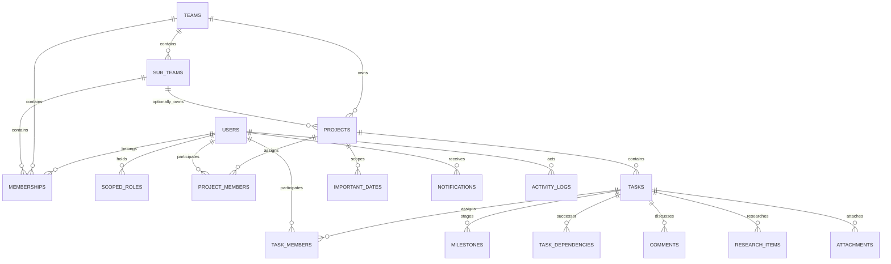

# Entity schema

The canonical executable definition is `database/migrations/001_initial_schema.sql`.

Queryable relationships use join tables rather than encoded lists. Foreign keys preserve history by restricting aggregate deletion or nulling optional actor references. Mutable projects/tasks use integer versions for compare-and-swap updates. Composite uniqueness prevents duplicate memberships and assignments.

Migration `003_organization_settings.sql` stores organization-wide preferences. Sub-team links appear in the sidebar by default until a global administrator saves a different preference.

Migration `004_pending_attachment_deletions.sql` records file removals in the same transaction that deletes their metadata. A file leaves the queue after successful removal.

Migration `005_workspace_revision.sql` creates a singleton revision for background browser updates. Successful workspace API mutations increment it. Its initial row is internal application state.

